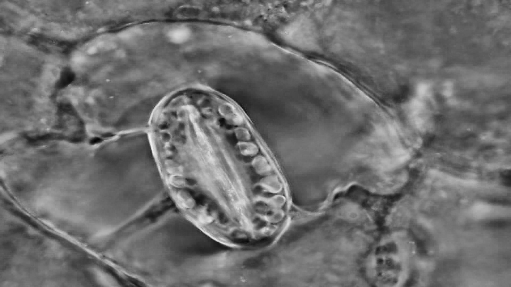
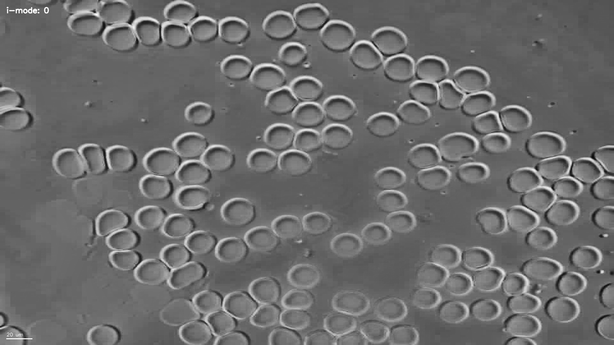
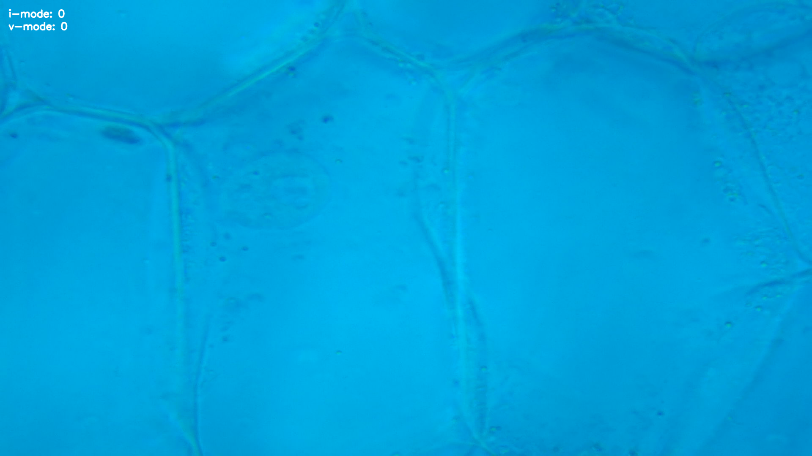
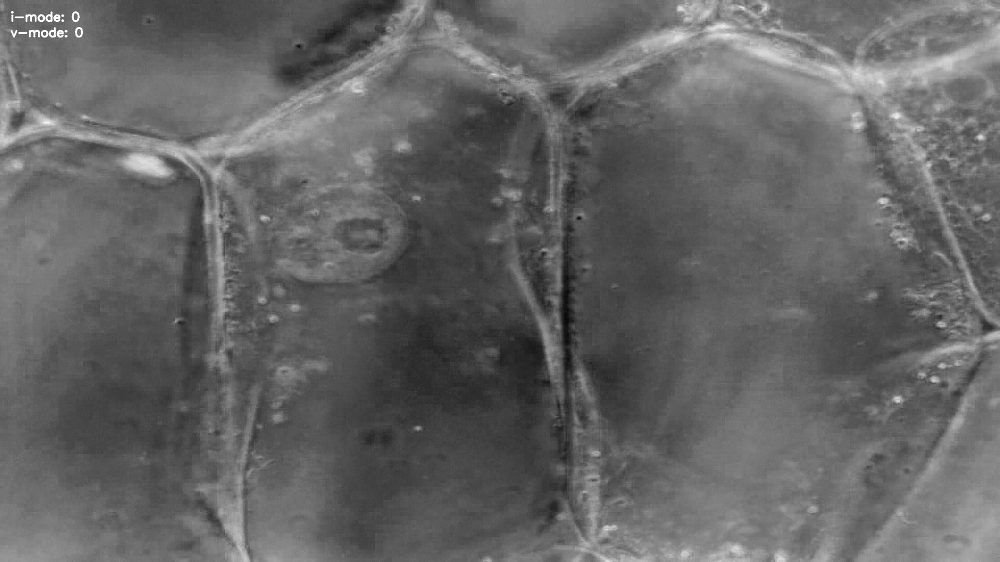

# Red-blue-computational-microscopy

Computational phase-contrast microscopy using red-blue LED illumination, a USB camera input, and Python/OpenCV on a standard brightfield microscope.

## Publication & Theory
For optical theory and methodology, see the accompanying paper:
* **[Dual-Wavelength Phase Contrast Using RGB Channel Differencing (PDF)](Phase%20Contrast%20Using%20RGB%20Channel%20DifferencingMay2026.pdf)** — *Jan de Jong (2026)*
* 🎥 **Video Demo:** [Watch Living Onion Epidermis (*Allium cepa*) Cytoplasm on YouTube](https://www.youtube.com/watch?v=Ga1p1tmAX3w) *(60x objective)*


## Controls

| Key | Action |
| :--- | :--- |
| <kbd>ESC</kbd> | Quit |
| <kbd>p</kbd> | Cycle view (`phase` / `overlay` / `raw`) |
| <kbd>n</kbd> | Toggle noise reduction |
| <kbd>m</kbd> | Toggle scale bar |
| <kbd>c</kbd> | Cycle contrast modes |
| <kbd>w</kbd> | Toggle soft white background |
| <kbd>e</kbd> | Cycle emboss modes |
| <kbd>i</kbd> | Cycle improvement (`off` / `micro` / `medium` / `strong`) |
| <kbd>v</kbd> | Cycle intensity cutoff (`off` / `20%` / `40%`) |
| <kbd>s</kbd> | Save normal frame (`PNG`) |
| <kbd>q</kbd> | Super-resolution still (3-frame average, `PNG`) |
| <kbd>1</kbd> | Start/stop recording (25 FPS `WMV`) |
| <kbd>2</kbd> | Start/stop recording (time-lapse 3 FPS -> 25 FPS) |
| <kbd>3</kbd> | Start/stop recording (time-lapse 10 FPS -> 25 FPS) |


## What You Need
* An industrial USB camera on the microscope
* Red and blue illumination setup - RGB LED puck light for example
* a diffusor on the LED - I used folded plastic sandwich bag
* Python 3 installed on your computer

Install Python libraries in case of Windows,
import cv2, 
import numpy as np, 
from datetime import datetime,




## Example Captures

| Capture 1 | Capture 2 | Capture 3 |
| :---: | :---: | :---: |
|  |  |  |

## How It Works
* **Red-Blue Illumination:** Uses directional red and blue light sources to capture phase gradients across transparent microscopic specimens.
* **Real-Time Processing:** Reads a live USB microscope camera feed in Python (`Phase_Live_ViewEmboss41.py`) and computes embossed/phase-contrast views with adjustable intensity cutoffs.
* **Standard Microscope Compatible:** Upgrades a regular brightfield microscope into a computational phase-contrast setup without expensive optical hardware.

## Quick Start
1. **Install dependencies:**
   ```bash
   pip install opencv-python numpy
   ```
2. **Run the live view script:**
   ```bash
   python Phase_Live_ViewEmboss41.py
   ```

## Files in This Repository
* `Phase_Live_ViewEmboss41.py` — Main Python script for live red-blue computational phase contrast.
* `record_mode1_2026-06-04_11-00-29.wmv` — Sample recorded microscope video feed.
* `superres_2026-10-15_22-54-50.png` & `capture_*.png` — Example processed microscope captures.

import os,
import sys,

## How to Run
1. Download this repository (click the green **Code** button -> **Download ZIP**).
2. Install the required libraries:
   `pip install -r requirements.txt`
3. Open the `.py` file in IDLE (or your terminal) and run it.
